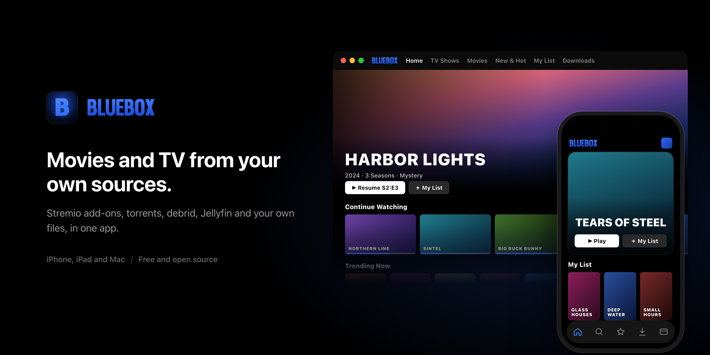

<div align="center">



<br><br>

<a href="https://bcyayay14.github.io/bluebox/add.html?to=altstore"></a>
&nbsp;
<a href="#iphone-and-ipad"></a>
&nbsp;
<a href="https://github.com/BCYAYAY14/bluebox/releases/latest/download/Bluebox-mac.dmg"></a>

<sub><a href="https://github.com/BCYAYAY14/bluebox/releases/latest">Latest release</a> · iOS 18 and later · Apple silicon Macs · <a href="LICENSE">MIT licence</a></sub>

</div>

---

Bluebox is a free, open-source movie and TV app for iPhone, iPad and Mac, styled like Netflix. It doesn't host anything: it plays what you bring, from Stremio add-ons, torrents, debrid services, Jellyfin and your own files.

## iPhone and iPad

**AltStore, SideStore or Feather:** tap **[Add to AltStore](https://bcyayay14.github.io/bluebox/add.html?to=altstore)** on your iPhone. The [add page](https://bcyayay14.github.io/bluebox/add.html) also has SideStore and Feather buttons.

**FlareStore, ESign or anything else:** add this source (use the copy button on the right of the box):

```
https://raw.githubusercontent.com/BCYAYAY14/bluebox/main/source.json
```

1. Open your sideloading app and go to **Sources**.
2. Tap **+** and paste the link.
3. Open **Bluebox** in the source and tap **Get**. New versions show up there as updates.

Prefer the file? [Download the latest IPA](https://github.com/BCYAYAY14/bluebox/releases/latest/download/Bluebox.ipa) and sideload it.

## Mac

1. [Download Bluebox for Mac](https://github.com/BCYAYAY14/bluebox/releases/latest/download/Bluebox-mac.dmg).
2. Open the DMG and drag **Bluebox** to **Applications**.
3. Open Bluebox. It isn't notarized, so the first time macOS says it can't check it. Click **Done**, then go to **System Settings › Privacy & Security**, scroll down and click **Open Anyway** next to Bluebox. macOS only asks once per version.

Needs macOS 15 or later on an Apple silicon Mac.

## What it does

- **A Netflix-style home:** Continue Watching, My List, your own lists and smart lists, Top Picks, and what's new.
- **Plays what you bring:** Stremio add-ons, torrents (streamed while they download), debrid services, Jellyfin, direct links and your own files.
- **A proper player:** subtitles in your style, audio and subtitle tracks, chapters, skip intro and credits, picture in picture, and speed control.
- **Downloads** for watching offline, with Smart Downloads that keep the next episodes ready and clear the watched ones.
- **Profiles,** each with its own lists, progress and statistics.
- **Optional sync** of lists, progress and settings between your devices, through your own free Supabase project, plus Trakt.
- **Your iPhone as a remote** for Bluebox on your Mac.
- **Privacy & Features:** every feature that could feel invasive has its own switch in Settings.

## Building from source

You need Xcode and [XcodeGen](https://github.com/yonaskolb/XcodeGen).

The code is in the [`Bluebox`](Bluebox) folder.

```bash
brew install xcodegen
cd Bluebox && xcodegen generate && open Bluebox.xcodeproj
```

Pick the **Bluebox-iOS** or **Bluebox-macOS** scheme. Set your own team under Signing & Capabilities, or change `DEVELOPMENT_TEAM` in `project.yml`. The torrent engine ships prebuilt, with its wrapper's source in `Packages/BlueboxKit/LibTorrent/LibTorrentEngine`.

Nothing needs a key to build. A TMDB token, OMDb ratings and the rest are entered in the app's Settings (without TMDB, Bluebox uses Cinemeta). For built-in Supabase or Trakt defaults, copy `Config/Example.xcconfig` to `Config/Secrets.xcconfig` and fill it in.

Run the tests with:

```bash
cd Bluebox/Packages/BlueboxKit && swift test
```

Pull requests are welcome.

## Good to know

Bluebox is a player. It doesn't host or index anything: what you watch comes from the add-ons and peers you choose, and you're responsible for having the right to watch it.

**Torrents share your IP address.** By default Bluebox streams torrents peer to peer, and uploads to other peers while it does. Everyone in the swarm can see your IP address. For more privacy, use a debrid service (Settings › Torrents & Debrid), which streams over HTTPS instead, or a VPN. You can also stop uploading: Settings › Torrents & Debrid › Upload Limit › Don't Upload.

This product uses the TMDB API but is not endorsed or certified by TMDB.

## Licence

Bluebox is released under the [MIT licence](LICENSE). Third-party components (libtorrent, Boost, VLC through SwiftVLC and others) are used under their own licences; see [THIRD-PARTY-NOTICES.md](THIRD-PARTY-NOTICES.md).
